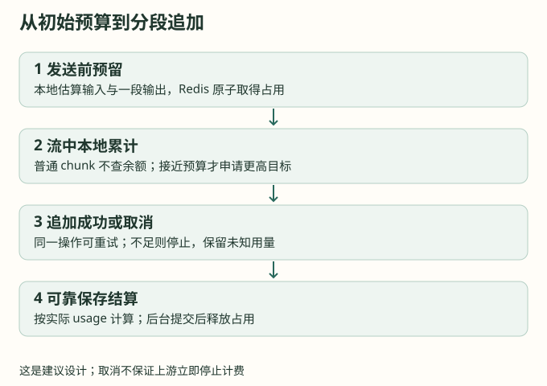

# 第 12 章：长请求按段追加预算

普通短回答不需要持续访问余额。长输出则可以先获得一小段预算，在接近用完时申请下一段。这兼顾低启动占用和风险控制，但不能把供应商未知的实时成本变成精确值。

## 12.1 为什么只查余额没有用

如果实际费用要等流结束才扣，流中反复 GET 到的余额可能一直不变。多个请求都认为账户还有钱，却都在继续消耗。因此检查必须伴随预算占用；否则它只是观察旧值。

建议流程如下：

```text
首次预留输入费用和一段输出预算
  → 本地累计估算消费
  → 接近已获预算时，原子申请更高目标预算
     → 成功：继续读取与转发
     → 不足：发起上游取消，输出协议对应的不完整终态
  → 保存最终用量证据，可靠提交结算任务
```



## 12.2 用目标总额表达追加

接口可以设计为 `reserve_to(request_id, operation_seq, target_amount)`。目标从 100 增到 160 时，服务只追加 60；同一操作重试不能再次追加。金额和序号都应受限，晚到的低版本操作不能覆盖高版本状态。

Lua 内先读取当前预留与终态，计算差额，再检查账户可用预算。已结算、已释放或已进入不可续期的状态应拒绝追加。这个接口不同于 sub2api 当前登记请求的脚本，不能直接重复 HSET 金额而不维护总额。

## 12.3 把触发点留在本地

假设当前输出预算为 10000 微美元，业务选择在估算已消耗 8000 时申请下一段。阈值只是示例，实际应根据生成速度、Redis 延迟分布和取消延迟设置。每个 chunk 只更新本地累计值，不进行网络访问；同一请求最多有一个正在执行的追加操作。

申请期间可以有限地继续处理已有缓冲，但必须限定字节、时间和额外预算。追加失败后，取消上游与发送错误终态只各执行一次；不能把预算不足误转成成功结束标记，也不应静默换到另一个模型继续收费。

## 12.4 风险怎样估算

假设第 i 个请求的消费速度最多为 r_i，检查与取消延迟为 d_i，计量误差为 e_i，那么额外暴露可粗略写成：

```text
额外暴露 ≈ Σ(r_i × d_i + e_i)
```

这不是严格欠费上界，除非 r、d 和误差都有可验证的上限。隐藏推理、工具、音频和供应商忽略取消都会破坏假设。对这些模型可以使用更高初始预算、单独工具额度、较小并发或明确的最大输出参数。

## 12.5 续期与追加是不同操作

续期只延长当前占用的生存时间，不增加金额；追加只增加授权预算，仍需遵守所有权和版本。进程失联后租约过期应进入待核查，而不是宣称费用归零。

允许小额损失的产品可以规定某类未知预留何时释放，但要把它列为风险政策，统计释放后实际账单的差额。不要在实现中用一个 TTL 隐藏这项业务决定。

**练习：** 同一追加操作因超时被重试，第一次其实已经成功。用目标预算和操作序号证明第二次不会把占用翻倍；再说明旧进程晚到的追加如何被拒绝。
