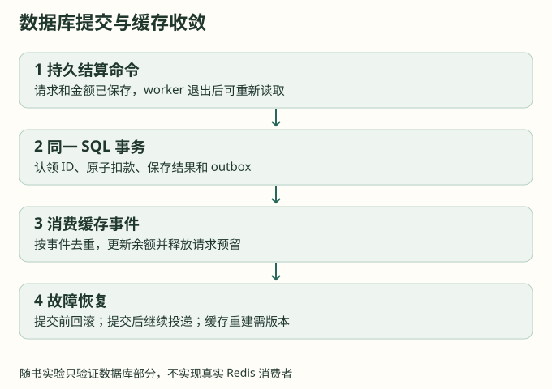

# 第 13 章：多进程扣费与跨存储恢复

原子减余额解决了并发覆盖，却没有解决重复消息和跨系统提交。可靠结算需要知道某笔消费是否已写入数据库，以及同一结果是否已反映到缓存。数据库与 Redis 不能仅靠调用顺序假装成为一个事务。

## 13.1 两进程并发的正确边界

余额 10，两进程各读到 10，分别算出 7 和 6 再覆盖，最终可能只扣其中一笔。数据库应使用 `balance = balance - amount`，并将请求去重与扣款放在同一事务。所有金额使用统一精度，条件判断和实际修改不可分离。

初始预留也一样：余额 10、两笔都申请 6，Redis Lua 必须让第二笔看到第一笔已占用的 6。应用层互斥锁只能保护一个进程，不能替代共享存储约束。

## 13.2 可靠结算分成两次提交

设计上，响应结束后先把结算命令可靠保存；后台在数据库事务中认领结算 ID、扣减实际费用、写入不可变结果，并写一条待更新缓存的 outbox 事件。事务提交成功，才允许发布这条事件。

缓存消费者以事件 ID 去重，在同一次 Lua 中调整余额缓存、释放对应预留、记录处理位置。直到数据库结果已经提交且缓存占用处理完成，才确认该事件。重复投递可以发生，但不得重复扣费或重复释放。

```text
可靠命令 → SQL 事务［去重 + 扣款 + 结算结果 + outbox］
         → 缓存消费者 → Lua［版本检查 + 余额增量 + 释放预留］
         → 确认事件
```



## 13.3 outbox 不解决所有丢失窗口

outbox 解决数据库提交与事件发布之间的缝隙。若最终 usage 还只在 handler 内存中，进程就在写结算命令前退出，outbox 尚不存在。此时必须依靠持久预留、上游请求标识、周期性证据或账单对账恢复，无法凭空推导最终费用。

同样，Redis 只在内存保存预留时，Redis 故障也会丢失占用。AOF、复制与确认策略有各自延迟和数据丢失边界，不能把“用了 Redis”直接写成“绝不丢账”。若要求恢复全部在途事实，必须增加可靠的预留事件或持久账本，并承担相应写入成本。

## 13.4 乱序、重复与重建

消费事件 A 和 B 到达顺序不同，简单余额增量在没有重建时可以交换，但版本与去重记录仍需正确维护。若采用顺序位置，必须识别事件间隙，不能收到 B 后就把尚未到达的 A 误判为过期。

缓存重建应从一致的数据库余额快照和对应事件位置开始，再恢复未结束预留，随后处理快照之后的事件。读旧余额、覆盖 Redis、重放任意旧事件这三步不能无协调并发执行。异常恢复可以按账户隔离，正常账户继续走一次 Lua 的准入路径。

充值、退款、管理员调整也应进入同样的账务事件机制。否则即便消费扣费精心去重，一次直接 SET 余额仍可能覆盖其他进程已经应用的费用。

## 13.5 必须演练的崩溃窗口

| 崩溃位置 | 恢复所需证据 |
| --- | --- |
| 预留后、上游发送前 | 预留身份、执行状态与所有权版本 |
| 上游可能执行、usage 未保存 | 上游标识、未知状态与对账来源 |
| 结算命令保存后、扣款前 | 持久命令重放 |
| 数据库提交后、缓存更新前 | outbox 待处理事件 |
| 缓存更新后、确认事件前 | 缓存侧去重和状态版本 |
| 缓存全部重建 | 一致快照、事件位置与未结束预留 |

本书实验只覆盖数据库部分的持久命令、原子扣费、去重和 outbox 恢复。不能把 SQLite 实验通过当作 Redis 集群、SQL 多方言或供应商对账已经通过。

**练习：** 两个 worker 同时消费同一结算命令，一个在扣款语句后退出。事务回滚与唯一键分别解决哪个问题？如果改成扣款后再单独写去重记录，会出现什么？
